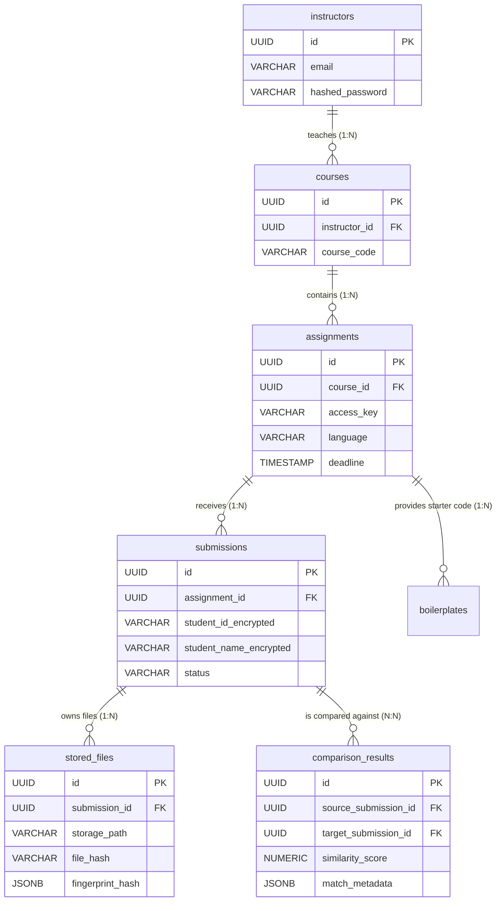

# 🗄️ Code-Checker Database Architecture

Welcome to the **Code-Checker** database documentation! This document is designed for developers of all skill levels—whether you are a seasoned Database Administrator or a "noob" who is just starting to learn how web applications store data.

This guide explains **what** tables we have, **why** they are designed this way, and **how** they talk to each other to make the application work securely and efficiently.

---

## 🧭 1. General Concepts (For Beginners)

Before we dive into the exact tables, here are a few critical concepts:

*   **Table:** Think of a table like a single sheet in an Excel workbook. It holds a specific type of data (e.g., one table just for Instructors, another just for Assignments).
*   **Primary Key (`id`):** Every row in a table gets a unique identifier (usually a randomly generated UUID, like `123e4567-e89b...`). This ensures we can always find exactly one specific record without confusing it with another.
*   **Foreign Key (e.g., `course_id`):** This is how tables "talk" to each other (Relationships). If an Assignment belongs to a Course, the Assignment table will have a column called `course_id` saving the Primary Key of that Course. This creates a **One-to-Many** relationship (One Course has Many Assignments).
*   **Encryption:** To strictly follow privacy laws (like FIPPA in Canada/Ontario), we do not save student names or IDs in plain text! They are mathematically scrambled (encrypted) before they even touch the database.

---

## 🗺️ 2. Entity-Relationship Diagram (ERD)

Below is a visual map showing how all 7 tables in our PostgreSQL database connect to one another.

---

## 📚 3. Detailed Table Breakdowns

### 1. `instructors` Table
This is the heart of our user management. It stores the professors or TAs who log into the dashboard.

| Column Name | Data Type | Constraints | Description & Purpose |
| :--- | :--- | :--- | :--- |
| **`id`** | `UUID` | **Primary Key** | A unique random string identifying the instructor. |
| **`name`** | `VARCHAR` | Not Null | The instructor's full display name (e.g., "Jane Doe"). |
| **`email`** | `VARCHAR` | Unique, Not Null | Used for logging in. Must be unique across the system. |
| **`hashed_password`** | `VARCHAR` | Not Null | We *NEVER* store raw passwords. This is heavily hashed using bcrypt. |
| **`created_at`** | `TIMESTAMP` | Default: `now()` | Automatically records the exact moment they registered. |

### 2. `courses` Table
Instructors can teach multiple courses. This table helps group assignments so the dashboard stays organized.

| Column Name | Data Type | Constraints | Description & Purpose |
| :--- | :--- | :--- | :--- |
| **`id`** | `UUID` | **Primary Key** | Unique identifier for the course. |
| **`course_code`** | `VARCHAR` | Not Null | E.g., "COSC 4P02". |
| **`term`** | `VARCHAR` | Not Null | E.g., "Fall 2026". Helps sort older courses. |
| **`instructor_id`** | `UUID` | **Foreign Key** | Who teaches this? Points directly to the `instructors.id`. Delete the instructor, delete the course (Cascade). |

### 3. `assignments` Table
Each piece of homework sits here. This table also manages the "Access Key" mechanism so students don't have to create accounts!

| Column Name | Data Type | Constraints | Description & Purpose |
| :--- | :--- | :--- | :--- |
| **`id`** | `UUID` | **Primary Key** | Unique identifier for the assignment. |
| **`course_id`** | `UUID` | **Foreign Key** | Points to `courses.id`. Groups the assignment. |
| **`title`** | `VARCHAR` | Not Null | E.g., "A1: Sorting & Winnowing Algorithms". |
| **`access_key`** | `VARCHAR` | Unique, Not Null | The critical sharing key (e.g., `cosc4p02-a1-test`). Students type this in to submit code anonymously! |
| **`language`** | `VARCHAR` | Not Null | E.g., "JAVA", "C", "CPP". Tells the backend tokenizer how to read the code. |
| **`deadline`** | `TIMESTAMP` | Not Null | Submissions trying to upload past this time are rejected. |
| **`status`** | `VARCHAR` | Default: `Open` | Can be 'Open', 'Closed', or 'Archived'. |

### 4. `submissions` Table
When a student uploads their zip file, we track the attempt here. **Privacy Note:** You will not find plain-text names here.

| Column Name | Data Type | Constraints | Description & Purpose |
| :--- | :--- | :--- | :--- |
| **`id`** | `UUID` | **Primary Key** | Unique identifier for the submission block. |
| **`assignment_id`** | `UUID` | **Foreign Key** | Links to `assignments.id`. |
| **`student_name_encrypted`** | `VARCHAR` | Not Null | Ciphertext locking away the name (AES Fernet). |
| **`student_id_encrypted`** | `VARCHAR` | Not Null | Ciphertext locking away their student number/email. |
| **`timestamp`** | `TIMESTAMP` | Default: `now()` | Exact time the upload reached the server. |
| **`status`** | `VARCHAR` | Default: `Active` | 'Active' or 'Archived' (if they re-submit). |
| **`attempt_number`** | `INTEGER` | Default: `1` | Tracks how many times they submitted (Max 3). |

### 5. `stored_files` Table
A single student submission usually contains multiple source code files (`main.java`, `utils.java`). This child table handles tracking them across our MinIO disk drive!

| Column Name | Data Type | Constraints | Description & Purpose |
| :--- | :--- | :--- | :--- |
| **`id`** | `UUID` | **Primary Key** | Unique identifier for this file. |
| **`submission_id`** | `UUID` | **Foreign Key** | Links to `submissions.id`. |
| **`storage_path`** | `VARCHAR` | Not Null | The bucket location telling MinIO exactly where to fetch the actual `.java` byte data. |
| **`file_hash`** | `VARCHAR` | Not Null | A SHA-256 hash of the exact file text. If two files have the identical hash, they are 100% physically identical. |
| **`fingerprint_hash`** | `JSONB` | Nullable | Saves the Winnowing algorithm footprints (`k-grams`) so we don't have to re-tokenize text twice, solving system lag! |

### 6. `comparison_results` Table
When you click **"Run Analysis"**, the AI compares every 'Active' submission against every other 'Active' submission. The math scores live here.

| Column Name | Data Type | Constraints | Description & Purpose |
| :--- | :--- | :--- | :--- |
| **`id`** | `UUID` | **Primary Key** | Unique identifier for the pair result. |
| **`source_submission_id`** | `UUID` | **Foreign Key** | Links to `submissions.id` (Student A). |
| **`target_submission_id`** | `UUID` | **Foreign Key** | Links to `submissions.id` (Student B). |
| **`similarity_score`** | `NUMERIC(5,2)`| Not Null | Percentage overlap metric (e.g., 94.20%). |
| **`match_metadata`** | `JSONB` | Nullable | Most important field! Holds the arrays `{ "source_ranges": [{"start": 10,"end": 50}], ... }` mapping exactly WHICH raw code character offsets matched between the two students. Powers the side-by-side frontend highlights! |

### 7. `boilerplates` Table
*(Optional but powerful structure for later)* Instructor-provided "Starter Code". You don't want to accidentally flag 50 students for copying `class Main { public static void main() }` if you gave it to them!

| Column Name | Data Type | Constraints | Description & Purpose |
| :--- | :--- | :--- | :--- |
| **`id`** | `UUID` | **Primary Key** | Unique identifier. |
| **`assignment_id`** | `UUID` | **Foreign Key** | Links to `assignments.id`. |
| **`hashed_fingerprint`** | `JSONB` | Not Null | Any token hash matches found in here are heavily ignored by the winnowing engine during student comparisons. |

---

## 🔒 Security Summary

1. **Relations cascade upon user deletion:** If an Instructor drops an account, all Courses $\rightarrow{}$ Assignments $\rightarrow{}$ Submissions $\rightarrow{}$ Comparisons are wiped securely.
2. **Stateless Submissions:** Because of the `access_key` in the `assignments` table, students do not exist in a "Users" table. They provide data and leave. Their IP address is never stored.
3. **No Raw Plaintext:** PII (Personally Identifiable Information) goes exclusively into `VARCHAR` columns built for holding long base64 cypher strings (`student_name_encrypted`). Even if a hacker dumps this database, they will simply stare at a wall of garbage text.
